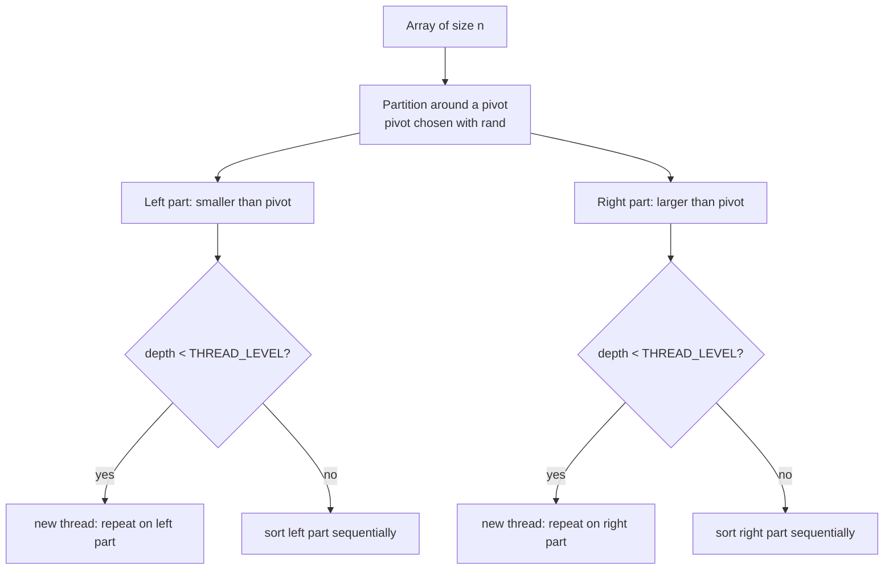
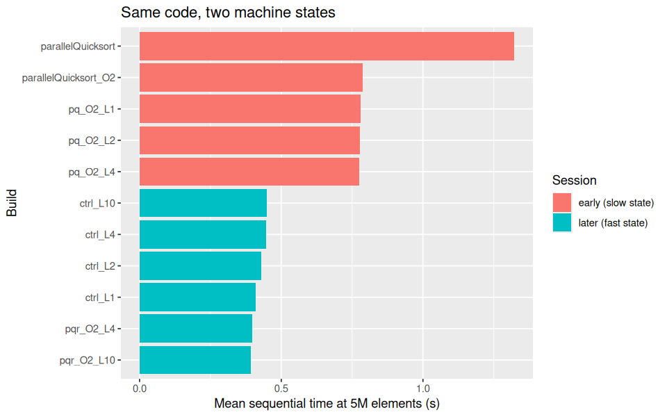
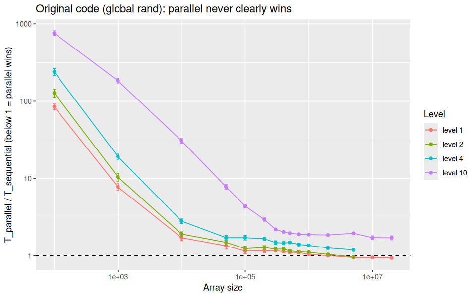
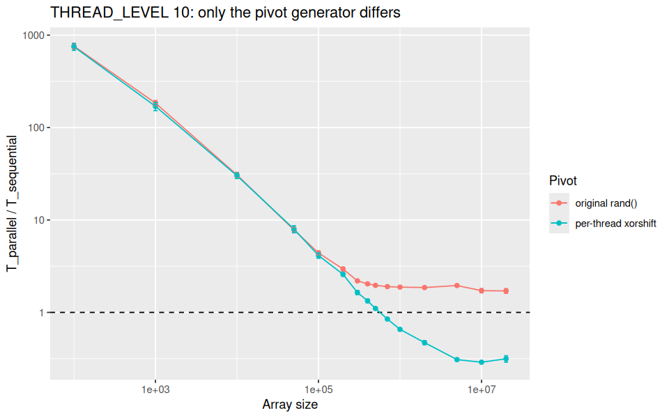
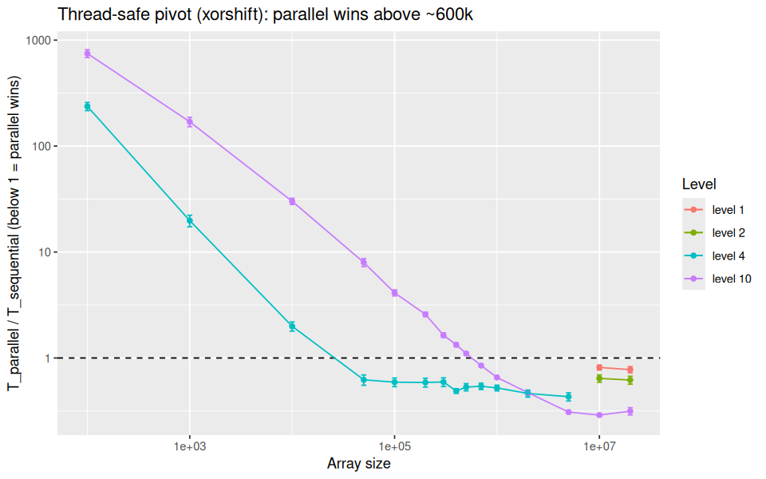
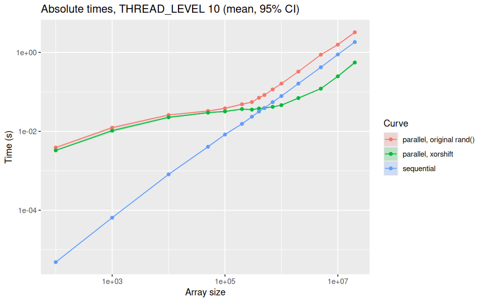

# Parallel Quicksort: my performance evaluation journal

The code, scripts and raw data are in the folder [`quicksortfork`](../quicksortfork) of this repository.

## 1. Objective

A multi-threaded quicksort was written in C (src/parallelQuicksort.c, Pthreads). It is stated that it saves time, and the author's notes say it becomes worth it above about 400,000 elements.

The goal is to check whether the author's experiment really supports this claim, fix what is wrong with the way it was measured, and then understand the results obtained.

## 2. Glossary

| Term | Meaning |
|---|---|
| Sequential | One thread sorts the whole array |
| Parallel | After each split a new thread sorts each half down to a fixed depth |
| THREAD_LEVEL (L) | How deep the recursion keeps creating threads. Level L gives up to 2^L tasks (L=1: 2, L=10: 1024). The original code uses 10 |
| Ratio | T_parallel / T_sequential for the same run. Below 1 means parallel is faster. Speedup is 1 / ratio. |
| 95% CI | 95% confidence interval on the mean over 30 repetitions |
| Pivot | The element used to split the array the original code picks it with rand()|

## 3. My Machine

All experiments ran on the school computer ensietuHP02 (Intel Core i5-1235U, 12 logical CPUs, hybrid P/E cores, Ubuntu on native Linux, gcc with -O2) on 2026-11-11.

## 4. How the code works



One detail turned out to be very important. The partition step calls `rand()` (line 156 of the original file) to choose every pivot. In glibc, `rand()` has one global state protected by a lock, and all threads share it.

## 5. What was wrong with the original experiment

| Problem | Why it matters |
|---|---|
| Compiled with -O0 | Real programs are not built like that, and it slows the sequential code|
| Only 5 repetitions | I can't tell a real effect from noise, and I can't compute a confidence interval|
| Only 5 sizes (powers of 10) | His 400,000 threshold sits in a gap between 100,000 and 1,000,000 where he has no data |
| Fixed run order | Machine state (heat, background load) gets mixed up with the effect of the size |
| No statistics | The threshold was read off a rough plot |
| No machine description | Nobody can compare the results with another computer |
| Bug in csv_quicksort_extractor2.pl | It prints $pqr instead of $par, so the parallel column is empty |
| THREAD_LEVEL fixed to 10 | Nobody checked if 1024 tasks is a good choice |

## 6. How I redesigned the experiment

Two scripts (run_benchmarking_v2.sh for sizes 100 to 5M, run_benchmarking_large.sh for 10M and 20M) write the timings of each run to a CSV file. The R scripts analyze.R, significance.R, ratio.R and make_figures.R then compute the means, confidence intervals, paired differences and the figures

- **Sizes:** 100, 1k, 10k, 50k, 100k, 200k, 300k, 400k, 500k, 700k, 1M, 2M, 5M with the first script, then 10M and 20M with a second one. I put several sizes around 400k because that is where the claim is
- **Repetitions:** 30 for every size and every binary
- **Order:** I shuffle all (size, repetition) pairs with shuf, so no size is measured in one block
- **Pairing:** each run times sequential, parallel and qsort on the same array, so I compute the ratio inside each run
- **Output:** the script writes a CSV directly, so I don't need the buggy Perl parser

### 6.1 The binaries I compared

| Name | Pivot | Level | Why |
|---|---|---|---|
| `parallelQuicksort` | `rand()` | 10 | Original build, `-O0` |
| `parallelQuicksort_O2` | `rand()` | 10 | Original code, `-O2` |
| `pq_O2_L1`, `_L2`, `_L4` | `rand()` | 1, 2, 4 | To test "too many threads" |
| `ctrl_L1`, `_L2`, `_L4`, `_L10` | `rand()` | 1, 2, 4, 10 | Same binaries run again later as controls (see 7.2) |
| `pqr_O2_L1`, `_L2`, `_L4`, `_L10` | xorshift per thread | 1, 2, 4, 10 | To test the `rand()` lock |

I did not edit the original source for the thread levels. I copied it with `sed` and changed one line:

```bash
sed "s/#define THREAD_LEVEL 10/#define THREAD_LEVEL $L/" src/parallelQuicksort.c > /tmp/pq_L$L.c
gcc -O2 -pthread -std=c99 -o src/pq_O2_L$L /tmp/pq_L$L.c -lrt
```

For the thread-safe pivot, I replaced `rand()` in `partition` by a small xorshift generator whose state is a `static __thread` variable, so each thread has its own. I built these variants the same way, with `-D_GNU_SOURCE`.

## 7. What I did and what I found

### 7.1 Experiment 1: reproduce the claim

With a proper design, the original code never beats sequential, from size 100 up to 5M. The ratio goes from about 700 at size 100 down to about 1.45 at 5M with `-O2` (first session, I correct this value in 7.2)

At small sizes the parallel version needs about 6 ms even for 100 elements, while sequential needs 0.00001 s. Creating threads costs far more than the sorting itself

So I could not reproduce "worth it above 400000"

### 7.2 Experiment 2: fewer threads, and a problem with my machine

My first idea was that level 10 creates too many threads. I built levels 1, 2 and 4 and measured them. The ratio went down steadily from level 10 to level 1, and level 1 was slightly below 1 from about 2M.

Then I noticed something wrong. I ran sequential at 5M by hand and got about 0.40 s, but in my early benchmark sessions the same code took about 0.78 s. The built-in `qsort` showed the same factor of 2. So the machine was in a different state during the early sessions. I think it was the power state, but I did not prove it. Figure 5 shows the two groups.



To find out if this broke my results, I ran the same binaries again (`ctrl_*`) in the fast state. At 5M:

| Build | Ratio, early session | Ratio, fresh control |
|---|---|---|
| level 1 | 0.954 | 0.951 |
| level 2 | 0.959 | 0.966 |
| level 4 | 1.200 | 1.191 |
| level 10 | 1.446 | 1.954 |

Levels 1, 2 and 4 gave almost the same ratio, so the slow state affected parallel and sequential equally and the ratio survived. Level 10 did change a lot. From here on I only use the `ctrl_*` and `pqr_*` data for conclusions. I keep the early runs only to tell this story :)

Original code (`rand()`), fresh controls, ratio with the 95% CI half-width in brackets:

| Size | L1 | L2 | L4 | L10 |
|---|---|---|---|---|
| 100k | 1.150 (0.080) | 1.237 (0.087) | 1.714 (0.115) | 4.399 (0.228) |
| 500k | 1.109 (0.031) | 1.155 (0.039) | 1.487 (0.046) | 1.961 (0.034) |
| 1M | 1.045 (0.019) | 1.112 (0.026) | 1.360 (0.057) | 1.878 (0.034) |
| 2M | 1.002 (0.014) | 1.041 (0.023) | 1.262 (0.048) | 1.858 (0.033) |
| 5M | 0.951 (0.017) | 0.966 (0.020) | 1.191 (0.046) | 1.954 (0.041) |
| 10M | 0.951 (0.014) | not run | not run | 1.718 (0.091) |
| 20M | 0.938 (0.015) | not run | not run | 1.708 (0.098) |



With the original `rand()`, fewer threads is always better, and the best case (level 1) only gives about 5 to 6% from 5M. At that point I believed the problem was "too many threads". The next experiment showed I was only half right XD

### 7.3 Experiment 3: remove the lock in `rand()`

I looked at where the threads could be waiting for each other, and `rand()` in `partition` was the obvious suspect. My hypothesis: the global lock makes the threads wait, and fewer threads only helped because there was less waiting. To test it, I replaced `rand()` with a per-thread xorshift generator and changed nothing else.

Ratio with the 95% CI half-width in brackets, measured the same day as the controls:

| Size | `ctrl_L10` (rand) | `pqr_L10` (xorshift) | `pqr_L4` (xorshift) |
|---|---|---|---|
| 1M | 1.878 (0.034) | 0.655 (0.022) | 0.522 (0.033) |
| 2M | 1.858 (0.033) | 0.471 (0.023) | 0.463 (0.035) |
| 5M | 1.954 (0.041) | 0.309 (0.011) | 0.431 (0.038) |
| 10M | 1.718 (0.091) | 0.289 (0.011) | not run |
| 20M | 1.708 (0.098) | 0.315 (0.025) | not run |

For levels 1 and 2 with xorshift, I only measured 10M and 20M: level 1 gives 0.813 and 0.776, level 2 gives 0.642 and 0.619.





Once the lock is gone, level 10 goes from about 1.7 times slower than sequential to about 3.2 times faster at 10M to 20M. Now more threads is better: level 10 beats 4, which beats 2, which beats 1. That is the opposite of what I saw in experiment 2, so my "too many threads" explanation was wrong. The real problem was contention on `rand()`.

### 7.4 Where parallel starts to win with the fixed code

I used the paired difference (parallel minus sequential) with a 95% CI.

| Level | Result |
|---|---|
| 10 | Sequential is faster up to 500k (+3.6 ms, CI above 0). Parallel wins from 700k (-7.5 ms, CI below 0). So the crossover is around 600k. The speedup is 2.1x at 2M and 3.2x at 5M. |
| 4 | Parallel is faster at every size I tested from 50k up (I did not test below 50k). The ratio is 0.52 at 1M and 0.43 at 5M. |

Level 4 is better from 50k to 2M and level 10 is better from 5M, so a level in between may be the best choice overall. I did not test that.

### 7.5 Checks I made

- **Correctness:** I checked by hand that the modified binaries still sort correctly (no "Oops, lyst did not get sorted" message at 5M)
- **Is xorshift unfair to the comparison?** The sequential time at 10M is the same with `ctrl_L1` and `pqr_O2_L1` (0.83 s and 0.82 s), so the new generator does not make the sequential code faster
- **Is the machine stable now?** Repeated sequential runs vary by about 5% (0.40 to 0.44 s at 5M, 0.84 to 0.94 s at 10M), and 10M takes about twice as long as 5M, as it should

## 8. Conclusions

1. I could not reproduce my colleague's claim on the original code. With level 10 and `rand()`, parallel is slower than sequential at every size from 100 to 20M, about 1.7 to 2 times slower from 100k up.
2. The cause is contention on the global lock inside `rand()`, which every thread calls in `partition`. I confirmed it with a controlled experiment, I did not just guess it.
3. With a per-thread pivot generator, parallel wins from about 600k elements (level 10) and reaches a speedup of about 3.2 at 10M to 20M on this 12-thread CPU.
4. So "worth it above about 400,000" is roughly right, but only for the fixed code (my crossover is about 600k). His own data could not show this, because his sample was too small.
5. Lowering `THREAD_LEVEL` only hides the problem by reducing contention, and it gains at most about 6%.
6. What I learned about method: repeat the runs, shuffle the order, watch the machine state, and rerun a control whenever a result looks strange. The machine-state change doubled my absolute times and I would have missed it without the control.

My first two explanations ("too many threads" and "the first sequential partition limits the speedup") were both wrong or incomplete, and experiment 3 showed it.

## 9. Limits

- One machine, one day, and threads were not pinned to cores (the CPU is hybrid)
- The early slow state was probably due to the power state which I did not record so this is only a guess
- Only random data was used (no sorted, reversed or many-duplicate arrays).
- My xorshift pivot is coarse and starts from the same state in every thread. The sort is correct but the pivots differ from the original which may change the work a little
- With the thread-safe pivot, levels 1 and 2 were only measured at 10M and 20M, and level 4 up to 5M
- The lock was shown to be the cause by removing it not by measuring the waiting time directly
